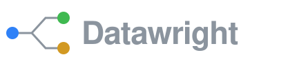
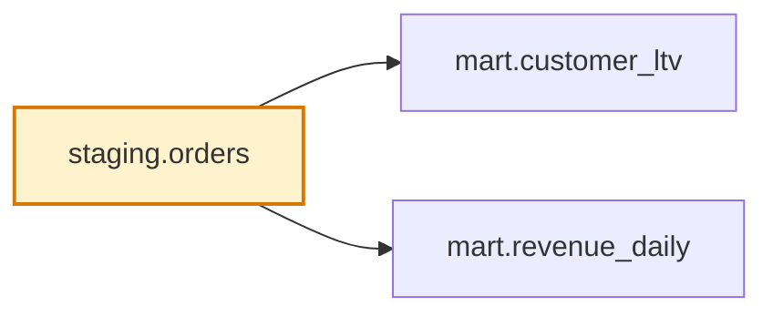

<div align="center">



### Know what breaks before you merge.

`datawright` is a local command that reads your data repo's code and tells you, and your AI agent,<br>the lineage, join paths and column meanings. No warehouse access, no model tokens, one file.

[](https://github.com/clementlemon02/datawright/actions/workflows/ci.yml)
[](LICENSE)
[](https://www.python.org)
[](https://agentskills.io)

[Quick start](#quick-start) · [What you get](#what-you-get) · [Benchmarks](#how-well-does-it-work) · [FAQ](#faq) · [Reference](docs/reference.md) · [Roadmap](ROADMAP.md)


</div>

## Why

Agents and reviewers guess. Datawright answers from your repo, with no warehouse access and no model tokens, in seconds.

| Without it | With it |
|---|---|
| "Which tables does this change break?" Nobody knows until a dashboard does. | A comment on every merge request: changed tables, the DAG tasks that run them, downstream tables and dashboards. |
| The agent joins two tables on whatever column names match. | `datawright join a b` writes the join your code already uses, with casts. |
| What does `status = 2` mean? Ask someone who left. | The card says `2 = approved`, learned from your own `CASE` expressions. |
| A rerun silently doubles yesterday's rows. | `datawright lint` flags appends with nothing clearing the slice first. |

In a merge request, `datawright review` adds a graph. This is its output for the change in the demo above (dashed arrows are links it inferred):



## What you get

- **Impact on every merge request.** `datawright review` labels each change breaking or non-breaking (dropped or recomputed column, changed filter or join, or just an added column), lists changed tables, the Airflow task that runs each, what's downstream (tables, Looker, Superset and Metabase dashboards), broken data contracts, and unsafe patterns.
- **Lineage down to the column.** Which columns feed which. Every table card names the file and line that writes and reads it, and links that were worked out rather than read plainly are marked `(inferred)`.
- **Join paths and meanings.** How tables join as your code joins them, what codes like `status = 2` mean, which key columns nothing uses any more.
- **Any agent can use it.** A command line, plus an MCP server (`datawright serve`) for clients with no shell.
- **11 agent skills on top** (set up, build, change, debug, test, review, optimize, on-call, tickets) that teach your agent to use it like a senior data engineer.

**Reads:** SQL · dbt · Airflow · Dagster · Spark · Flink · Kafka · Java (MyBatis) · Looker · Superset · Metabase · data contracts (ODCS). Anything else: a small connector.
**Agents:** Claude Code · Codex · Cursor · Gemini CLI · anything that reads [Agent Skills](https://agentskills.io).

## Quick start

You need [uv](https://docs.astral.sh/uv/) and git.

**1. Try the tool.** One minute, no agent needed. From your data repo's root:

```bash
uvx datawright-cli init
.data-context/dw card <a table you know>
.data-context/dw impact <that table>
```

Want `dw` on your PATH everywhere? `uv tool install datawright-cli`. On a feature branch, `.data-context/dw review --base main` prints the merge-request report. `.data-context/dw coverage` lists what it doesn't read in your repo yet.

**2. Give your agent the skills.** Claude Code:
```
/plugin marketplace add clementlemon02/datawright
/plugin install data-eng@datawright
```

Codex, Cursor, Gemini CLI and others (swap `-a`):
```bash
npx skills add clementlemon02/datawright -a codex
```

Then tell your agent **"set up this repo"** and ask: *"What breaks if I change `orders_daily`?"*, *"How do `sessions` and `regions` join?"*, *"Review my changes before I open a PR."*

No data repo handy? Try [examples/shop](examples/shop), a small warehouse with planted bugs.

## How well does it work?

| Test | Result |
|---|---|
| Table lineage vs dbt's own manifest, three public dbt projects | **100% precision, 99.5–100% recall** |
| Questions agents answered correctly on a hard synthetic warehouse (Sonnet) | **12 of 12 with Datawright, 7 of 12 without** |
| Same test, Haiku | 7–8 of 12 with it, 3 of 12 without |
| Index build, 220-file production Airflow repo | under 2 seconds |

Six public repos run in CI at pinned commits, so any change in what it finds is reviewed. The agent benchmark is small and home-made: [methods and limits](docs/semantics.md#results-so-far-the-join-path-benchmark).

## How is it different?

| | Data catalogs (DataHub, OpenMetadata) | dbt-centric review (Datafold, Recce, SQLMesh) | **Datawright** |
|---|---|---|---|
| Where it looks | Metadata ingested from your tools | Your dbt project and warehouse | Your repo's code, read directly |
| Beyond dbt (Airflow, Spark, Java, Kafka) | Through ingestion connectors | No | Yes |
| Comparing the actual data before and after | No | **Yes, row and value diffs** | Aggregates only |
| Impact comment on every merge request | Not their job | Yes | Yes |
| Built for an agent to query | Some, via MCP | Some | Yes: cards, `join`, MCP server |
| Setup | A service to run | A warehouse connection, often a paid plan | One file, no service, no credentials |

They coexist: Datawright imports from them and can [export to dbt, DataHub and OpenMetadata](docs/reference.md#everything-datawright-answers). If you only run dbt, you may already have most of the lineage; the merge-request report and join paths are what's new.

## FAQ

**Does it touch my warehouse or send data anywhere?** No. `datawright` reads code, makes no network calls and never writes. Optional read-only queries need a read-only user you set up.

**Which warehouse and SQL dialects?** Anything sqlglot parses, auto-detected, including Snowflake, BigQuery, Trino, StarRocks, Doris, Spark and DuckDB.

**What if it doesn't understand part of my repo?** `datawright coverage` lists what it skips. A connector, usually a few dozen lines, teaches it, and setup can write one for you.

**How do I know it's right?** Every answer points at the file and line it came from, `datawright coverage` lists what it can't read and how many links are inferred, and lineage is scored against dbt's own manifest in CI. It's a heuristic parser, so check surprising results and [report wrong lineage](docs/try-it.md).

**Is it production-ready?** It's a first release, tested by its author on public repos and one production platform. [Ten minutes and five answers](docs/try-it.md) from you would help the most.

## More

[Skills and every command](docs/reference.md) · [Architecture](ARCHITECTURE.md) · [Roadmap](ROADMAP.md) · [Landscape](docs/landscape.md) · [Contributing](ARCHITECTURE.md#contributing)

MIT license
