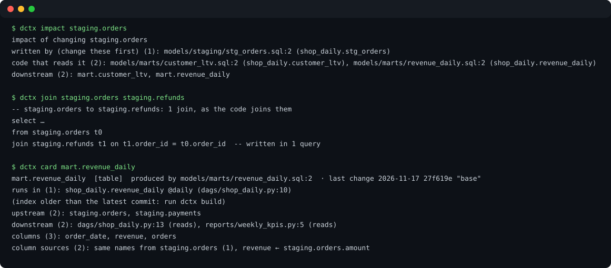

<div align="center">


### Know what breaks before you merge.

Datawright reads your data team's code and gives your AI agent and your reviewers<br>the lineage, join paths and column meanings they can't see.

[](https://github.com/clementlemon02/datawright/actions/workflows/ci.yml)
[](LICENSE)
[](https://www.python.org)
[](https://agentskills.io)

[Quick start](#quick-start) · [What you get](#what-you-get) · [Benchmarks](#how-well-does-it-work) · [FAQ](#faq) · [Reference](docs/reference.md) · [Roadmap](ROADMAP.md)



</div>

## Why

Agents and reviewers guess. Datawright answers from your repo, with no warehouse access and no model tokens, in seconds.

| Without it | With it |
|---|---|
| "Which tables does this change break?" Nobody knows until a dashboard does. | A comment on every merge request: changed tables, the DAG tasks that run them, downstream tables and dashboards. |
| The agent joins two tables on whatever column names match. | `dctx join a b` writes the join your code already uses, with casts. |
| What does `status = 2` mean? Ask someone who left. | The card says `2 = approved`, learned from your own `CASE` expressions. |
| A rerun silently doubles yesterday's rows. | `dctx lint` flags appends with nothing clearing the slice first. |

## What you get

- **Impact on every merge request.** Run `dctx review` in CI or by hand. It lists changed tables, the Airflow task that runs each, what's downstream (tables, Looker, Superset and Metabase dashboards), broken data contracts, and unsafe patterns.
- **Column-level lineage and meaning.** Which columns feed which, how tables join, what codes mean, and which key columns no code uses any more.
- **11 skills for your agent.** Set up, build, change, debug, test, review, optimize, on-call and ticket workflows, so it works like a senior data engineer.
- **Open and small.** One Python file (`dctx`) and plain `SKILL.md` files. A CLI, or an MCP server for any MCP client.

**Reads:** SQL · dbt · Airflow · Dagster · Spark · Flink · Kafka · Java (MyBatis) · Looker · Superset · Metabase · data contracts (ODCS). Anything else: a small connector.
**Works with:** Claude Code · Codex · Cursor · Gemini CLI · any agent that reads [Agent Skills](https://agentskills.io).

## Quick start

You need [uv](https://docs.astral.sh/uv/) and git.

**1. Install the skills**

Claude Code:
```
/plugin marketplace add clementlemon02/datawright
/plugin install data-eng@datawright
```

Codex, Cursor, Gemini CLI and others (swap `-a`):
```bash
npx skills add clementlemon02/datawright -a codex
```

**2. Set up your repo.** In your data repo, tell your agent: **"set up this repo"**. It installs `dctx`, builds the index and writes an `AGENTS.md` with your real commands.

**3. Ask.**
- *"What breaks if I change `orders_daily`?"*
- *"How do `sessions` and `regions` join?"*
- *"Review my changes before I open a PR."*

No data repo handy? Try [examples/shop](examples/shop), a small warehouse with planted bugs. No agent? `uv run <path to>/skills/data-context/scripts/dctx.py init` builds the index alone.

## How well does it work?

| Test | Result |
|---|---|
| Table lineage vs dbt's own manifest, three public dbt projects | **100% precision, 96–100% recall** |
| Questions agents answered correctly on a hard synthetic warehouse (Sonnet) | **12 of 12 with Datawright, 7 of 12 without** |
| Same test, Haiku | 7–8 of 12 with it, 3 of 12 without |
| Index build, 220-file production Airflow repo | under 2 seconds |

Six public repos run in CI at pinned commits, so any change in what it finds is reviewed. The agent benchmark is small and home-made: [methods and limits](docs/semantics.md#results-so-far-the-join-path-benchmark).

## How is it different?

| | Data catalogs (DataHub, OpenMetadata) | dbt, SQLMesh | **Datawright** |
|---|---|---|---|
| Source of truth | Metadata ingested from your tools | Your dbt models | Your repo's code, read directly |
| Beyond dbt (Airflow, Spark, Java, Kafka) | Through ingestion connectors | No | Yes |
| Impact comment on every merge request | Not their job | Within dbt | Yes |
| Built for an agent to query | Some, via MCP | Not their job | Yes: cards, `join`, MCP server |
| Setup | A service to run | Part of the project | One file, no service |

They coexist: Datawright imports from them and can [export to dbt, DataHub and OpenMetadata](docs/reference.md#everything-dctx-answers).

## FAQ

**Does it touch my warehouse or send data anywhere?** No. `dctx` reads code, makes no network calls and never writes. Optional read-only queries need a read-only user you set up.

**Which warehouse and SQL dialects?** Anything sqlglot parses, auto-detected, including Snowflake, BigQuery, Trino, StarRocks, Doris, Spark and DuckDB.

**What if it doesn't understand part of my repo?** `dctx coverage` lists what it skips. A connector, usually a few dozen lines, teaches it, and setup can write one for you.

**Is it production-ready?** It's a first release, tested by its author on public repos and one production platform. [Ten minutes and five answers](docs/try-it.md) from you would help the most.

## More

[Skills and every command](docs/reference.md) · [Architecture](ARCHITECTURE.md) · [Roadmap](ROADMAP.md) · [Landscape](docs/landscape.md) · [Contributing](ARCHITECTURE.md#contributing)

MIT license
